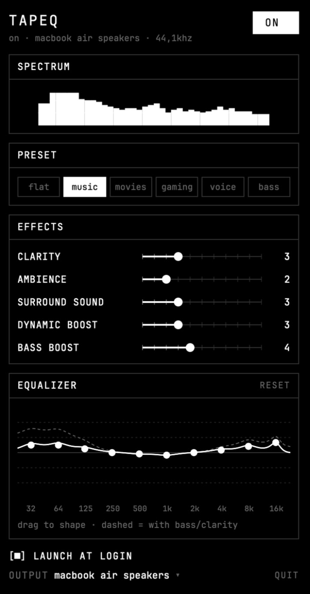

# TapEQ

A menu bar sound enhancer for macOS. TapEQ captures every app's audio with a Core
Audio **process tap**, runs it through its own effect chain, and plays the result on
your output device. No virtual audio driver is installed.

<p align="center">
  
</p>

From the menu bar panel you get:

- an on/off switch (off = apps play normally)
- a live spectrum
- presets: Flat, Music, Movies, Gaming, Voice, Bass
- five effects (0–10): Clarity, Ambience, Surround Sound, Dynamic Boost, Bass Boost
- a 10-band equalizer (32 Hz–16 kHz, ±12 dB), edited by dragging on a response
  graph. The dashed line also includes the Bass Boost and Clarity shelves.
- output device selection
- a Launch at login switch

Settings and the on/off state persist between launches.

## What the effects do

| Effect | At 10 |
| --- | --- |
| Clarity | +8 dB high shelf at 4.5 kHz plus a harmonic exciter |
| Ambience | room reverb (pre-delay, 8 combs) whose size and level grow with the slider; about -3 dB below the dry sound at 10 |
| Surround Sound | widens existing stereo up to 3× and synthesizes width for mono sources (mono-compatible) |
| Dynamic Boost | compressor with up to +15 dB make-up gain: quiet sounds come up, loud ones barely move |
| Bass Boost | +15 dB low shelf at 120 Hz |

A peak limiter at -0.4 dBFS always runs last, so heavy settings don't clip. The
numbers live in `EffectTuning` in `Sources/TapEQCore/SoundProcessor.swift`.

## Requirements

- macOS 15 or later
- Xcode with a Swift 6 toolchain (developed and tested with Xcode 27.1 / Swift 6.4)

## Build and run

```bash
git clone https://github.com/myUdav4iik/TapEQ.git
```

```bash
cd TapEQ && ./build-app.sh
```

```bash
open build/TapEQ.app
```

TapEQ has no Dock icon; look for the waveform icon in the menu bar. Use **Quit** in
the panel (or ⌘Q while it's open) to exit.

Run the tests with `swift test`.

To use **Launch at login**, first copy `build/TapEQ.app` to `/Applications` and open
it from there: the login item points at the exact app you enabled it from.

### Permissions and signing

The first time you switch TapEQ on, macOS asks to allow **System Audio Recording**.
If you deny it, the tap delivers silence and other apps stay muted while TapEQ is on.
Fix that under System Settings → Privacy & Security → Screen & System Audio
Recording.

macOS ties that permission to the app's signature. `build-app.sh` signs with your
first "Apple Development" identity (or `SIGN_IDENTITY` if set), so the permission
survives rebuilds. With no identity it falls back to ad-hoc signing, which makes
macOS ask again after every build.

Launch the app with `open` or from Finder. If you run the binary inside the bundle
from a terminal, macOS attributes the audio capture to the terminal.

## How it works

```
all apps ──► muted global tap ──► private aggregate device ──► IOProc ──► output device
                (excludes TapEQ)        (tap in, device out)      │
                                                                  ▼
     bass shelf → 10-band EQ → clarity → surround → ambience → dynamic boost → limiter
```

- `Sources/TapEQ/SystemAudioProcessor.swift`: tap, aggregate device and IOProc setup/teardown
- `Sources/TapEQ/HAL.swift`: Core Audio property helpers, device list, default-output switching
- `Sources/TapEQ/PanelView.swift`, `Graphs.swift`: the menu bar panel
- `Sources/TapEQCore/EQRenderer.swift`: real-time callback (no allocation, no blocking)
- `Sources/TapEQCore/SoundProcessor.swift`: the effect chain and its tuning
- `Sources/TapEQCore/SoundSettings.swift`: UI → audio thread parameter hand-off (try-lock)
- `Sources/TapEQCore/Spectrum.swift`: ring buffer + FFT for the spectrum

Picking an output device sets the system default output. TapEQ follows default-output
changes automatically by rebuilding the chain.

## Known limitations

- Rebuilding the chain on an output-device change causes a brief dropout.
- Filter coefficients switch instantly on a parameter change, so fast drags can
  produce faint zipper noise.
- Not notarized; distributing it needs a Developer ID signature and notarization.

## License

Copyright (C) 2026 Vadym

TapEQ is free software: you can redistribute it and/or modify it under the terms of
the GNU General Public License as published by the Free Software Foundation, either
version 3 of the License, or (at your option) any later version. It is distributed in
the hope that it will be useful, but WITHOUT ANY WARRANTY; see [LICENSE](LICENSE)
for details.
